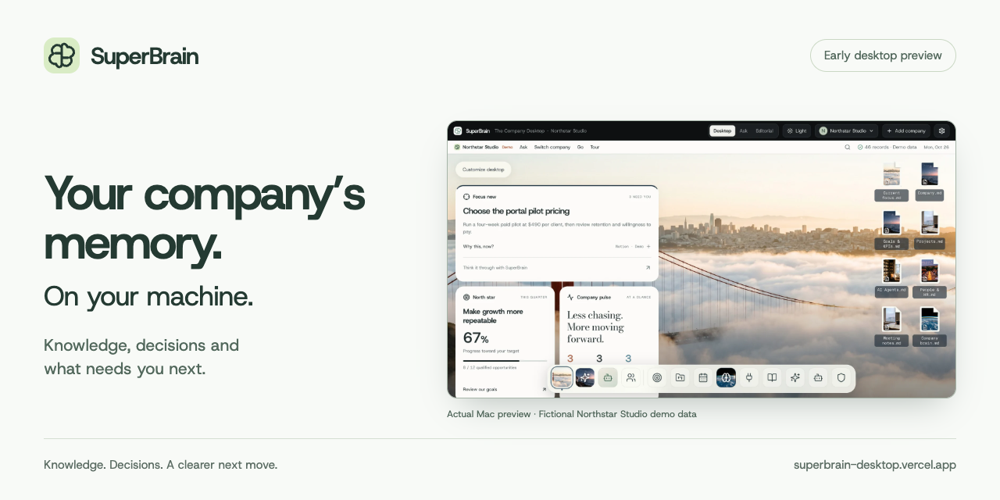
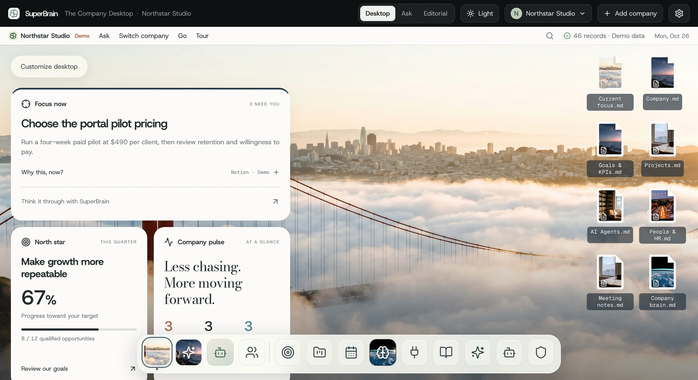
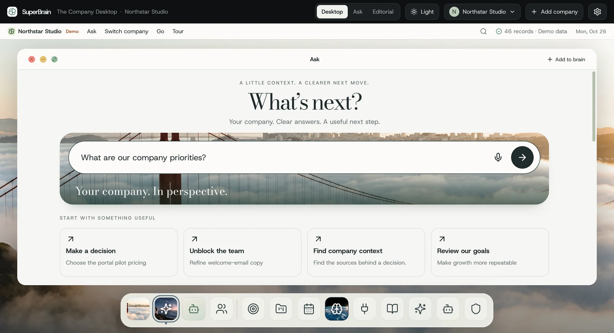
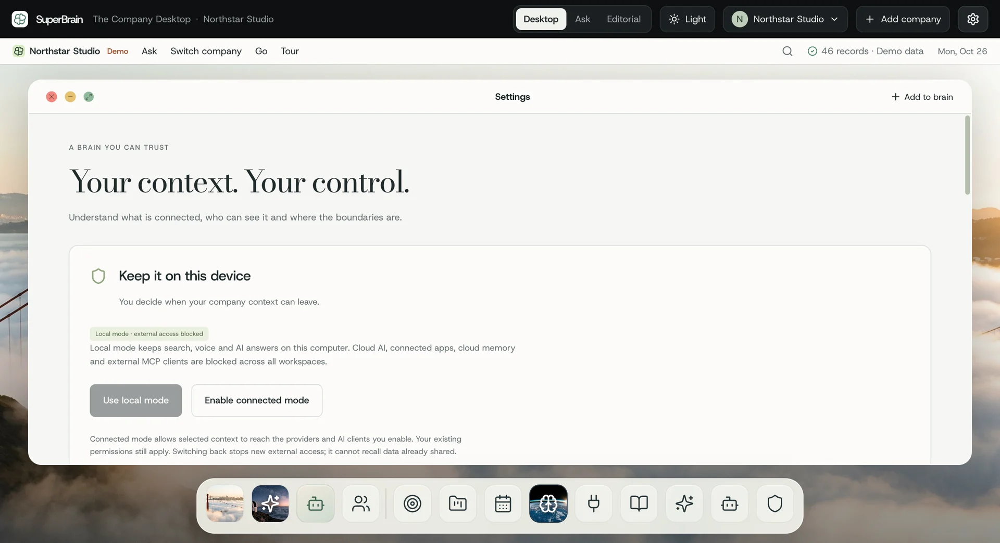

  

  <a href="https://superbrain-desktop.vercel.app"><strong>Explore SuperBrain</strong></a> ·
  <a href="#download-the-preview">Download preview</a> ·
  <a href="docs/getting-started.md">Getting started</a> ·
  <a href="https://github.com/megandmartin/superbrain-downloads/issues/new/choose">Give feedback</a>

# SuperBrain

Bring your company’s knowledge, decisions and priorities into one local desktop. Find the context behind a decision, ask questions of your company records, and see what needs your attention.

This is the public home for **preview downloads, release notes and feedback**. The app’s development repository is private.

For a technical look, read the [architecture, engineering tradeoffs and reproducible checks](docs/engineering.md). The public tooling distinguishes release integrity from behavior of the actual packaged app.

## A company desktop, with context

*An actual Mac preview with fictional Northstar Studio demo data. The figures and recommendations shown are examples.*

| When you need to… | SuperBrain brings together… |
| --- | --- |
| Make a decision | Priorities, recommendations and the context behind them. |
| Find the thinking behind it | Keyword and semantic search, with answers you can follow back to source records. |
| Keep control of company data | Local storage by default, plus an explicit choice before enabling connected services. |

<strong>See Ask and the privacy controls</strong>

### Ask your company a question

The Mac preview can download an optional model for on-device answers. Browsing and search work without that generation model.

### Choose when to connect

Local mode blocks cloud AI, connector calls and external MCP access. Connected mode requires separate setup and permissions. [Read the data guide](docs/privacy-and-data.md).

## Download the preview

**Current public release: [0.3.0 preview](https://github.com/megandmartin/superbrain-downloads/releases/tag/v0.3.0-preview.1)** · Published 29 October 2026

| Your computer | Installer | What to expect |
| --- | --- | --- |
| **Mac with Apple Silicon** · M1 or later, macOS 14+ | [Download Mac preview](https://github.com/megandmartin/superbrain-downloads/releases/download/v0.3.0-preview.1/SuperBrain-0.3.0-mac-arm64.dmg) · 364 MB | Native app, local generated answers and restart persistence checked on Apple Silicon. |
| **Windows x64 — earlier preview** · Windows 10/11, Intel or AMD | [Download Windows preview](https://github.com/megandmartin/superbrain-downloads/releases/download/v0.3.0-preview.1/SuperBrain-0.3.0-win-x64.exe) · 310 MB | Packaged runtime checked; full installation, local generation and physical microphone checks remain pending. |

> **Early preview:** both installers are unsigned for distribution; the Mac app is not notarized. Your operating system may warn or block installation. Read the [installation guide](docs/getting-started.md) and [platform limits](docs/preview-status.md) before installing. An Intel Mac build is not available; Windows ARM has not been validated.

[Release notes](https://github.com/megandmartin/superbrain-downloads/releases/tag/v0.3.0-preview.1) · [SHA-256 checksums](https://github.com/megandmartin/superbrain-downloads/releases/download/v0.3.0-preview.1/SHA256SUMS.txt) · [Third-party notices](https://github.com/megandmartin/superbrain-downloads/releases/download/v0.3.0-preview.1/THIRD-PARTY-NOTICES.zip)

## Start with the demo company

1. **Install and explore.** Open the fictional demo company. No cloud account or API key is needed to explore.
2. **Follow the context.** Open a decision, browse company records, then try search. [Take the short walkthrough](docs/getting-started.md#your-first-five-minutes).
3. **Add local AI when ready.** On Mac, open Settings → Local AI to download the optional model, approximately 2.5 GB. After setup, model-based answers run on your machine.

## Your workspace, your choice

- **Local by default.** Workspace data lives in the app’s data folder. Cloud AI and connected services require an explicit switch to Connected mode.
- **Back up before updating.** Updates are manual. Quit the app and copy the complete workspace folder first.
- **Understand the preview’s boundaries.** The published preview database is not encrypted by the app. Workspaces do not automatically sync, and this is not a hosted team service.

[Privacy and backups](docs/privacy-and-data.md) · [Website privacy details](https://superbrain-desktop.vercel.app/privacy)

## Help shape the next preview

Tell us what you were trying to do, what happened and what would have helped. [Report a reproducible problem or suggest an improvement](https://github.com/megandmartin/superbrain-downloads/issues/new/choose). Issues are public; use fictional examples and remove company records, credentials and personal information.

| Follow the work | Where to go |
| --- | --- |
| What shipped | [Changelog](CHANGELOG.md) |
| What is verified and what remains open | [Preview status](docs/preview-status.md) |
| How the app works and why | [Engineering and verification](docs/engineering.md) |
| Reproduce checks of the released Mac runtime | [Runnable harness](scripts/smoke-preview.mjs) and [recorded result](evidence/macos-runtime.json) |
| Check download integrity | [Release manifest](releases/preview.json) and [verification guide](CONTRIBUTING.md#release-verification) |
| Improve these public resources | [Contributing](CONTRIBUTING.md) |

