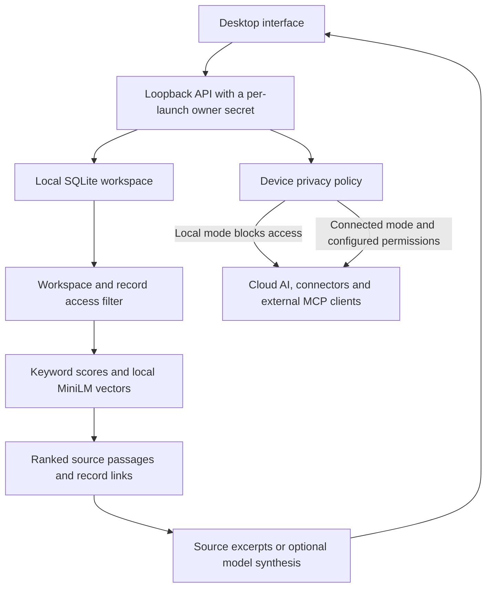

# Engineering and verification

SuperBrain is a local company workspace: records, decisions, retrieval and optional AI answers run behind a desktop interface. This page describes the published **0.3.0-preview.1 Mac build**, revision `b975ab71de7bf3335817807537bc01eabe75099e`. The Windows download is an earlier candidate; see the [platform status](preview-status.md).

The application source is private. This repository publishes installers, public test tooling and recorded results so a reviewer can inspect the checks and repeat them against a specific release.

## How the desktop fits together



The API binds to `127.0.0.1`. The packaged desktop supplies a random per-launch secret; a request with a missing secret or an unexpected host is rejected. Browser API requests also have origin checks. These controls protect a local owner session; they are not remote team authentication.

Retrieval filters records by access before searching, combines word scores and local vector rankings through reciprocal-rank fusion, and returns source passages. Access and source state are checked again after asynchronous retrieval work. Retrieval evidence and generated answers are separate: finding a relevant record does not establish that a model's answer is correct.

Local mode is the default service policy. Cloud calls, connectors and external MCP access require Connected mode. The optional generation-model download is a deliberate setup exception: it fetches a fixed public model file, without company records, and checks its pinned length and SHA-256 before use.

## Decisions and tradeoffs

| Decision | What it enables | Cost or boundary |
| --- | --- | --- |
| Keep the workspace in local SQLite | Records and search are usable without a hosted database or provider account. | Each installation has its own data. Backup is the owner's responsibility; the preview has no automatic sync or hosted collaboration. |
| Separate retrieval from optional generation | Search and source inspection work before a generation model is installed. | On-device generation needs a separate download of about 2.5 GB, disk space and suitable hardware. Answers still need source review. |
| Enforce owner access and privacy at runtime boundaries | Loopback access, per-launch secrets and connection policy restrict entry points beyond the visual settings screen. | A trusted local computer remains part of the threat model. The published database is not encrypted by the app; a compromised device is outside this protection. |
| Track each platform's exact artifact | Requirements, bytes, hashes and verification can be checked independently. | Mac and Windows are at different verification stages. A successful Mac check does not certify Windows or establish signing. |

## Inspect the evidence

| Evidence | What it checks | What it does not establish |
| --- | --- | --- |
| [Public repository CI](../.github/workflows/public-repo-checks.yml) | Verification-tool tests, documentation paths, release metadata and the published checksum file. | Native application behavior or installer acceptance. |
| [Release manifest](../releases/preview.json) | The specific published asset identities and platform disclosures used by the tools. | That an installer is signed, safe for every device, or useful to a customer. |
| [Mac runtime result](../evidence/macos-runtime.json) and [runnable harness](../scripts/smoke-preview.mjs) | Named HTTP-level assertions against the runtime inside the checksum-matched Mac installer, using temporary synthetic data. | Native GUI operation, a fresh installation, Windows parity, local model-answer accuracy or physical microphone behavior. |

The runtime report is a recorded local run, not an independent audit. The [Mac runtime workflow](../.github/workflows/mac-preview-smoke.yml) repeats the assertions on a hosted runner and retains its report. The public script makes the assertions inspectable; rerunning it gives stronger evidence than the checked-in report alone. Read the individual results and scope rather than inferring application coverage from a total test count.

## Repeat the Mac runtime check

On an Apple Silicon Mac, download the exact DMG from the [release manifest](../releases/preview.json). With Node.js 22 or later, run from this repository:

```sh
node scripts/smoke-preview.mjs \
  --dmg '/path/to/SuperBrain-0.3.0-mac-arm64.dmg' \
  --report artifacts/runtime-smoke.json
```

Choose a new JSON output path; the harness refuses to overwrite existing files. It checks the DMG's size and SHA-256 before running it, mounts it read-only, and starts its packaged runtime in a temporary workspace. It uses fictional records and a new owner secret, then stops the runtime and removes the temporary workspace. It does not use your installed workspace, configure an outside provider or download a generation model.

For download-only checks and verification-tool tests, use the [contribution guide](../CONTRIBUTING.md#release-verification). For signing, remaining platform checks and product limits, use [preview status](preview-status.md).
